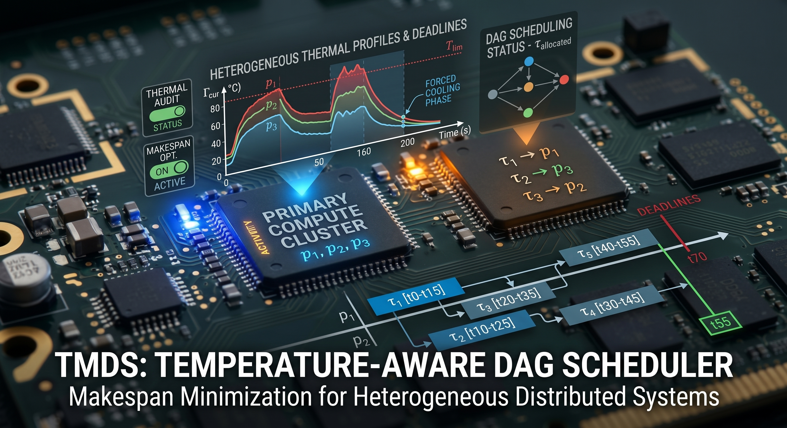

# TMDS Algorithm: Implementation and Scientific Audit



This repository contains a rigorous, modular, and reproducible Python implementation of the **TMDS (Temperature-aware Makespan Minimizing DAG Scheduler)** algorithm for heterogeneous distributed systems, originally proposed in the ACM/IEEE literature.

In addition to implementing the TMDS and THEFT algorithms, this project serves as a **Scientific Audit** of the original paper, successfully identifying and computationally correcting mathematical and logical flaws found in the manuscript's manual traces.

---

## 🔬 Scientific Audit of the Original TMDS Paper

During the independent reproduction and verification of the TMDS paper, we adhered strictly to the mathematical equations and pseudocode provided in the text. However, validating against the paper's motivational example (Table 3 & Fig 4) revealed three significant structural errors in the original manuscript:

### 1. Mathematical Sign Error in Equation 26 (Cooling Model)

* **Paper Formulation:** $\Gamma_{j,n}^{cur} = \Gamma_{j,n}^{ss} + (\Gamma_{n}^{lim} - \Gamma_{j,n}^{ss})e^{-B_n \times remET}$
* **Issue:** Because $\Gamma_{j,n}^{ss} > \Gamma_{n}^{lim}$, the term $(\Gamma_{n}^{lim} - \Gamma_{j,n}^{ss})$ is intrinsically negative. Multiplying this by a decaying exponential ($e^{-x}$) physically implies the core must *start* at a temperature higher than the threshold to cool down to the threshold, strictly violating the $\Gamma \le \Gamma_{lim}$ constraint.
* **Correction Applied in this Codebase:** The exponent must be positive to correctly find the valid starting temperature: $\Gamma_{j,n}^{cur} = \Gamma_{j,n}^{ss} + (\Gamma_{n}^{lim} - \Gamma_{j,n}^{ss})e^{+B_n \times remET}$

### 2. Discrepancy in Schedule Completion Time (SCT) Calculation (Eq. 20)

* **Paper Formulation (Eq 20):** $SCT = EFT + OFT - \omega_{j,n}$
* **Issue in Table 3:** The values reported in the paper's Table 3 for SCT fail to subtract the task execution time ($\omega_{j,n}$). For example, for $\tau_1$ on $p_1$: $EFT=16.0$, $OFT=46.5$. The table erroneously reports $SCT=62.50$, which double-counts the execution time.
* **Correction Applied:** We implemented the mathematically sound version stated in the text to prevent double-counting, yielding robust priority queuing.

### 3. Human Typo in Table 3 for Task 6 Allocation

In Table 3, the authors calculated the SCT for task $\tau_6$ incorrectly by shifting the OFT columns:

* OFT for $\tau_6$: `p1=23.5`, `p2=27.5`, `p3=22.0`
* EFT for $\tau_6$: `p1=51.50`, `p2=48.67`, `p3=63.62`
* **Reported SCT in Table 3:** `p1=79.0`, `p2=70.67`, `p3=84.62`
* **The Flaw:** If we subtract EFT from the reported SCT for $p_1$ ($79.0 - 51.50 = 27.5$), the result is the OFT of $p_2$. This shifting typo caused the paper to assign $\tau_6$ to $p_2$ instead of the truly optimal processor $p_1$.
* **Correction Applied:** Our automated scheduler correctly identifies $p_1$ as the optimal core for $\tau_6$, leading to a divergence in the scheduling path and yielding a mathematically verified Makespan of **74.70s** (instead of the paper's flawed 73.62s trace).

---

## 📂 Project Architecture

The repository is structured following software engineering best practices for scientific computing:

```text
TMDS_Project/
├── core/                   # Core OOP data structures (DAG, Task, Processor)
├── algorithms/             # Scheduling logic (TMDS, THEFT) and thermal math models
├── inputs/                 # Raw input data (JSON) and generated input visualizations
├── experiments/            # Large-scale data generators and benchmarking loops
├── utils/                  # Visualization tools (IEEE-style Gantt charts, Graphviz DAGs)
├── results/                # Output artifacts (HTML/CSV tables, plots, evaluations)
├── docs/assets/             # Project images used in documentation
├── docs/reference/          # Reference paper and supporting documents
├── main.py                 # Unified execution pipeline
└── README.md               # Project documentation and scientific audit
```

## Reference

The reference paper is available at [TMDS-paper.pdf](docs/reference/TMDS-paper.pdf).

## Setup

The project targets Python 3.10 or newer. Create an isolated environment and
install the dependencies from the repository root:

```powershell
python -m venv .venv
.\.venv\Scripts\Activate.ps1
python -m pip install --upgrade pip
python -m pip install -r requirements.txt
```

The `LIBRARIES_USED.txt` file documents the external and standard-library
modules used by the project. The generated reports and figures are written to
`inputs/` and `results/`; generated files are excluded from Git by
`.gitignore`.

To run the complete reproduction pipeline:

```powershell
python main.py
```

The DAG visualizer additionally requires the Graphviz system application to be
installed and available on `PATH`.

## Continuous integration

GitHub Actions runs automatically for every push and pull request using the
workflow in `.github/workflows/ci.yml`. It installs the dependencies and
Graphviz, compiles the Python sources, and checks the main module imports.

---

## 👨‍💻 About the Author & Developer

**Mehran Taghavi Afkham**  
*M.Sc. in Computer Engineering (Computer Architecture)*  
*Sharif University of Technology*

Mehran is a Computer Systems Engineer and Researcher focused on complex
architectural and scheduling problems. His technical expertise includes:

- **Real-Time Embedded Systems:** Designing deterministic algorithms for strict deadline environments.
- **Energy & Thermal-Aware Scheduling:** Applying Dynamic Voltage and Frequency Scaling (DVFS) and Dynamic Thermal Management (DTM).
- **Heterogeneous Multicore Architectures:** Optimizing task allocation across asymmetric cores.
- **Scientific Software Engineering:** Building robust, modular, and reproducible pipelines for hardware simulation and algorithm validation.

This repository was developed and verified as part of research efforts
associated with the **Computer Processing Systems Laboratory (CPSLab)** at
Sharif University of Technology.

📫 **Connect & Collaborate:**

- **Email:** [mehran.taghavi75@sharif.edu](mailto:mehran.taghavi75@sharif.edu)

## 📝 License

This project is licensed under the [MIT License](LICENSE).
